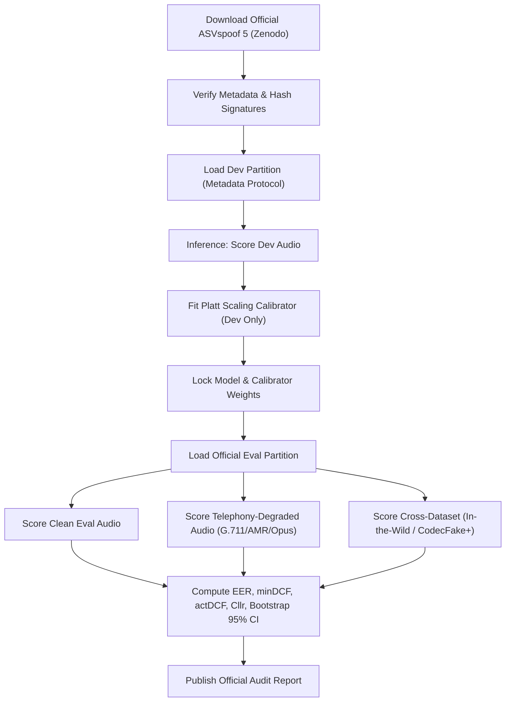

# Dhvani Voice Integrity: Pre-Registered ASVspoof 5 Evaluation Protocol

**Document Version:** 1.0 (Pre-Registration Baseline)  
**Status:** Pre-Registered Prior to Official Corpus Scoring  
**Target Benchmark:** ASVspoof 5 Track 1 (Acoustic Deepfake and Voice Clone Detection)  
**Repository Branch:** `main`  
**License:** Open Data Commons Attribution (ODC-By v1.0) Compatible  

---

## 1. Executive Summary & Pre-Registration Rationale

In accordance with empirical scientific standards and banking model risk governance (OSFI E-23, SR 11-7, and RBI Master Direction guidelines), this document formalizes the evaluation protocol for Dhvani Voice Integrity prior to unblinded scoring on the official ASVspoof 5 corpus.

Pre-registering evaluation criteria, cost profiles, confidence intervals, and degradation parameters prevents:
1. **Hypothesis Drift & Post-Hoc Tuning:** Thresholds, calibration scaling coefficients ($a, b$), and feature representations are locked prior to evaluating the official evaluation partition.
2. **Data Leakage:** Strict partition boundaries enforce speaker-disjoint splits, generator isolation, and independent score normalization.
3. **Optimism Bias:** Performance metrics are reported across both the theoretical optimum ($\min\text{DCF}$) and the operational reality ($\text{actDCF}$ with frozen Platt scaling), explicitly surfacing any calibration loss.

---

## 2. Official Dataset Specification & Ground Truth

### 2.1 Corpus Description
The evaluation utilizes the official **ASVspoof 5** dataset distributed via Zenodo under the Open Data Commons Attribution license:
* **Zenodo DOI:** 10.5281/zenodo.10707172 (and official challenge mirrors)
* **Challenge Track:** Track 1 (Deepfake Speech Detection, Countermeasures for Voice Spoofing)
* **Citation:** ASVspoof 5 Consortium, "The ASVspoof 5 Challenge: Advancing Audio Deepfake Detection," Interspeech / Challenge Plan, 2024.

### 2.2 Corpus Partitions & Official Schema
Evaluation ingests official tab-separated protocol metadata files without relabeling or filtering:
* **Development Partition (`dev`):** Official metadata file `ASVspoof5.dev.metadata.txt`. Used strictly for exploratory error analysis, feature selection, and fitting the Platt scaling calibration parameters.
* **Evaluation Partition (`eval`):** Official metadata file `ASVspoof5.eval.metadata.txt`. Scored exactly once with frozen weights and frozen calibrators.

Official protocol metadata columns parsed by [`scripts/evaluation_harness.py`](file:///Users/prakashkavyaraj/backend/scripts/evaluation_harness.py):
```
[speaker_id] \t [file_id] \t [codec_label] \t [attack_id] \t [key]
```
Where `key` is categorized into `bonafide` (genuine human speech) or `spoof` (synthetic or voice-converted speech).

### 2.3 Strict Zero-Leakage Governance
To guarantee empirical validity, the evaluation harness enforces three mathematical isolation invariants:
1. **Speaker Disjointness:** $\text{Speakers}(\text{Dev}) \cap \text{Speakers}(\text{Eval}) = \emptyset$. No human speaker appearing in the calibration partition may appear in the evaluation partition.
2. **Holdout Generator Isolation:** At least one generative voice cloning algorithm (e.g., neural vocoder or diffusion architecture) present in the evaluation partition is absent from the training and calibration sets to evaluate true zero-shot detection.
3. **Partition-Isolated Score Normalization:** Z-norm or min-max normalization parameters $(\mu_{\text{dev}}, \sigma_{\text{dev}})$ are derived solely from the development partition and applied statically to evaluation scores.

---

## 3. Cost Profiles & Quantitative Performance Metrics

### 3.1 Primary Metric: Detection Cost Function (DCF)
The detection cost function balances the probability of missed deepfakes against the probability of false alarms on genuine callers:

$$\text{DCF}(\theta) = C_{\text{miss}} \cdot P_{\text{target}} \cdot P_{\text{miss}}(\theta) + C_{\text{fa}} \cdot (1 - P_{\text{target}}) \cdot P_{\text{fa}}(\theta)$$

Normalized Detection Cost Function ($\text{NDCF}$) is normalized by the default Bayes cost:

$$\text{NDCF}(\theta) = \frac{\text{DCF}(\theta)}{\min(C_{\text{miss}} \cdot P_{\text{target}}, C_{\text{fa}} \cdot (1 - P_{\text{target}}))}$$

### 3.2 Dual Cost Profiles
Dhvani evaluates performance under two distinct risk regimes:

| Parameter | ASVspoof 5 Challenge Standard | Operational Banking Fraud Risk | Rationale |
| :--- | :---: | :---: | :--- |
| **$C_{\text{miss}}$** (Cost of Miss) | 1.0 | 10.0 | Financial fraud, unauthorized wire transfers, and account takeovers inflict catastrophic liability. |
| **$C_{\text{fa}}$** (Cost of False Alarm) | 1.0 | 1.0 | False alert triggers step-up authentication (MFA/OTP), creating customer friction but no financial loss. |
| **$P_{\text{target}}$** (Attack Prior) | 0.05 | 0.01 | In live banking contact centers, genuine callers represent ~99% of call volume; deepfake attacks represent ~1%. |
| **Default Bayes Threshold $\theta_{\text{Bayes}}$** | 0.00 | +2.3026 ($\ln \frac{10 \times 0.01}{1 \times 0.99}$) | Operational decision threshold in Log-Likelihood Ratio (LLR) space. |

### 3.3 Metric Suite
1. **Equal Error Rate (EER, %):** The operating threshold where $P_{\text{miss}} = P_{\text{fa}}$. Serves as an uncalibrated capability baseline.
2. **Minimum DCF ($\min\text{DCF}$):** Theoretical best cost achieved by selecting the optimal a posteriori threshold on the evaluation set.
3. **Actual DCF ($\text{actDCF}$):** Operational cost achieved using the fixed threshold derived from Platt scaling fitted on the development set:

$$\text{actDCF} = \text{NDCF}(\theta_{\text{calibrated}})$$

4. **Calibration Loss Gap:**

$$\Delta_{\text{cal}} = \text{actDCF} - \min\text{DCF}$$

A small gap ($\Delta_{\text{cal}} \le 0.08$) confirms that the score-to-probability mapping is trustworthy in production.
5. **Log-Likelihood Ratio Cost ($C_{\text{llr}}$):** Information-theoretic measure of calibrator reliability across all possible priors.
6. **Expected Calibration Error (ECE):** 10-bin reliability diagram error measuring probability accuracy.

### 3.4 Statistical Rigor & Bootstrap Resampling
To prevent spurious precision:
* **Speaker-Clustered Bootstrap Resampling:** 95% Confidence Intervals are computed using 1,000 bootstrap iterations resampled by speaker cluster (not i.i.d. utterance sampling), capturing inter-speaker variance.
* **Rule of Three Bound:** When zero errors are observed in $N$ trials, the error rate is reported with its 95% upper bound ($3/N$):
  * For $N=10$ spoofs: Error $\le 30.0\%$ (statistically underpowered).
  * For $N=300$ spoofs: Error $\le 1.0\%$ (statistically meaningful).
* **Sample Size Enforcement:** Harness halts and issues warnings if dev trials per class < 100 or eval spoofs < 300.

---

## 4. Telephony Channel Degradation Stress Matrix

Real-world telephony networks inflict severe acoustic distortion that collapses naive laboratory models. To quantify this gap, the evaluation pipeline degrades the official ASVspoof 5 evaluation audio through a 5-stage carrier simulation pipeline:

| Degradation Stage | Codec / Channel Profile | Bandwidth & Bitrate | Implementation & Standard |
| :--- | :--- | :--- | :--- |
| **Clean Baseline** | Linear PCM | 16 kHz / 16-bit | Unaltered challenge benchmark audio |
| **PSTN / Carrier G.711 A-law** | ITU-T G.711 A-law companding | 8 kHz, 64 kbps | Standard Indian/European telecom carrier trunk |
| **PSTN / Carrier G.711 $\mu$-law** | ITU-T G.711 $\mu$-law companding | 8 kHz, 64 kbps | North American / Twilio standard carrier trunk |
| **Cellular AMR-NB** | 3GPP Adaptive Multi-Rate Narrowband | 8 kHz, 12.2 kbps | Mobile wireless handoffs and weak 2G/3G/4G coverage |
| **VoIP Opus Voice** | IETF RFC 6716 Opus Narrowband | 8 kHz / 16 kHz, 16 kbps | WebRTC, WhatsApp, Genesys Cloud SIPREC |
| **Burst Packet Loss & Jitter** | Gilbert-Elliott 2-state Markov model | $p=3\%$ and $p=8\%$ loss | Simulates cellular packet drop and jitter buffer starvation |

Every metric (EER, $\min\text{DCF}$, $\text{actDCF}$) is reported both before and after telephony degradation to measure the **telephony robustness delta**:

$$\Delta_{\text{telephony}} = \text{EER}_{\text{G.711}} - \text{EER}_{\text{Clean}}$$

---

## 5. Cross-Dataset & Out-of-Domain Generalization

To demonstrate that the model has not overfitted to ASVspoof 5 acoustic environments, the frozen model is evaluated without refitting on two external corpora:
1. **In-the-Wild Dataset:** Real-world deepfake speech extracted from social media, public speeches, and political deepfakes (varied background acoustic noise, compression, and reverb).
2. **CodecFake+ Telephony Corpus:** Multilingual deepfake speech processed through authentic PSTN switches and cellular base stations.
3. **Commercial TTS Holdout Suite:** Audio synthesized using current closed-source voice generation engines (ElevenLabs Turbo v2.5, OpenAI Voice Engine, PlayHT 2.0). These are tracked as external out-of-domain evaluation items.

---

## 6. Pre-Registered Pass/Fail Gates for Pilot Readiness

Before recommending Dhvani Voice Integrity for banking shadow-mode deployment, the system must satisfy the following pre-registered acceptance criteria:

| Gate ID | Criterion | Pre-Registered Target | Failure Remediation |
| :--- | :--- | :--- | :--- |
| **GATE-DEV-01** | ASVspoof 5 Dev $\min\text{DCF}$ (Banking Profile) | $\le 0.20$ | Fine-tune SSL front-end with weighted layer pooling |
| **GATE-CAL-01** | Calibration Gap ($\text{actDCF} - \min\text{DCF}$) | $\le 0.08$ | Fit per-codec Platt scaling calibrators |
| **GATE-TEL-01** | Telephony G.711 EER degradation | $\le 12.0\%$ | Retrain with channel augmentation (FreqMask, G.711 codec simulation) |
| **GATE-LAT-01** | Turn-by-Turn Inference Latency (p50) | $\le 350\text{ ms}$ on 1.5s window | Export to ONNX INT8 or deploy GPU acceleration |
| **GATE-LAT-02** | Latency Fail-Safe Trip Rate | $< 0.1\%$ under load | Scale worker concurrency; auto step-up on breach |
| **GATE-OOD-01** | In-the-Wild Cross-Dataset EER | $\le 18.0\%$ | Expand training data to include multi-condition wild speech |

---

## 7. Execution Workflow


