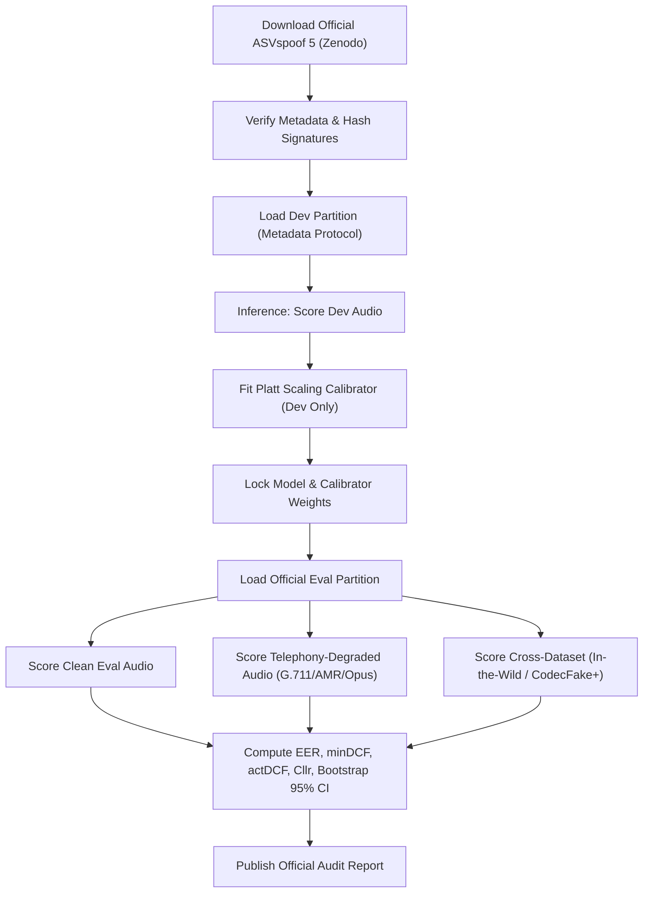

# Dhvani Voice Integrity: Pre-Registered ASVspoof 5 Evaluation Protocol

**Document Version:** 1.1 (Pre-Run Amendment Baseline)  
**Status:** Pre-Registered & Formally Amended Prior to Official Corpus Scoring  
**Target Benchmark:** ASVspoof 5 Track 1 (Acoustic Deepfake and Voice Clone Detection)  
**Repository Branch:** `main` (commit tag: `protocol-v1`)  
**License:** Open Data Commons Attribution (ODC-By v1.0) Compatible  

---

## 1. Executive Summary & Pre-Registration Rationale

In accordance with empirical scientific standards and banking model risk governance (OSFI E-23, SR 11-7, and RBI Master Direction guidelines), this document formalizes the evaluation protocol for Dhvani Voice Integrity prior to unblinded scoring on the official ASVspoof 5 corpus.

Pre-registering evaluation criteria, cost profiles, confidence intervals, and degradation parameters prevents:
1. **Hypothesis Drift & Post-Hoc Tuning:** Thresholds, calibration scaling coefficients ($a, b$), and feature representations are locked prior to evaluating the official evaluation partition.
2. **Data Leakage:** Strict partition boundaries enforce speaker-disjoint splits, generator isolation, and independent score normalization.
3. **Optimism Bias:** Performance metrics are reported across both the theoretical optimum ($\min\text{DCF}$) and the operational reality ($\text{actDCF}$ with frozen Platt scaling), explicitly surfacing any calibration loss.

### Protocol Version History & Formal Amendments
* **v1.0 (2026-10-18T03:51:00Z)**: Initial pre-registration baseline cataloging dual cost regimes, zero-leakage constraints, and degradation matrix.
* **v1.1 (2026-10-18T18:55:00Z: Pre-Run Amendment)**:
  1. **Official Cost Profile Alignment**: Amended the ASVspoof 5 standard profile to $C_{\text{miss}} = 10.0, C_{\text{fa}} = 1.0, P_{\text{target}} = 0.05$. In the official challenge evaluation plan (which uses a bonafide-target convention), the penalty for rejecting a genuine speaker is 1 and the penalty for accepting a spoof is 10. Under Dhvani's fraud-detection / spoof-positive convention (where spoof is the target class $y=1$), missing a spoof is penalized with cost 10 and false alarming on genuine speech is penalized with cost 1, yielding the exact official Bayes cost ratio ($\beta \approx 1.90$).
  2. **Model Provenance Disclosure (Zero-Shot Baseline)**: Formally disclosed that current model weights (AASIST-L trained on ASVspoof 2019 LA; Forensics-0.3B trained on open-source web/wild speech) were not trained on the ASVspoof 5 training partition (attacks A01-A08). The upcoming scoring run is explicitly classified as a **zero-shot cross-dataset evaluation**, which establishes the lower baseline before task-specific fine-tuning.
  3. **Dev vs. Eval Codec Mismatch Notice**: Highlighted that ASVspoof 5 Dev contains predominantly clean uncompressed speech, whereas Eval introduces evaluation conditions C01 through C11 (various lossy and transmission codecs). A calibrator fit on clean Dev audio is expected to experience calibration drift on Eval codecs unless codec augmentation is introduced.
  4. **Pilot Readiness Gate Rationales**: Renamed statutory gates to "Pilot readiness gates" and documented quantitative engineering justifications for each threshold.
  5. **Threshold Scale Harmonization**: Replaced probability-scale threshold ambiguities with the canonical invariant Log-Likelihood Ratio threshold ($\theta_{\text{LLR}} = \ln \beta$). Clarified that $\theta_{\text{LLR}} = +0.6419$ for ASVspoof 5 and $+2.2925$ for Banking Risk, while the true posterior probability cutoff under $P_{\text{target}}$ is $\frac{C_{\text{fa}}}{C_{\text{fa}} + C_{\text{miss}}} = \frac{1}{11} \approx 0.0909$ for both profiles.
  6. **Utterance-Level Window Aggregation & Fusion Invariants**: Documented and frozen the mathematical window pooling rules (median for Forensics-0.3B, 90th percentile for AASIST-L) and multimodal fusion weights prior to scoring the evaluation split.

---

## 2. Official Dataset Specification & Ground Truth

### 2.1 Corpus Description
The evaluation utilizes the official **ASVspoof 5** dataset distributed via Zenodo under the Open Data Commons Attribution license:
* **Zenodo DOI:** 10.5281/zenodo.14498691
* **Challenge Track:** Track 1 (Deepfake Speech Detection, Countermeasures for Voice Spoofing)
* **Citation:** ASVspoof 5 Consortium, "The ASVspoof 5 Challenge: Advancing Audio Deepfake Detection," Interspeech / Challenge Plan, 2024.

### 2.2 Corpus Partitions & Official Schema
Evaluation ingests official space-separated protocol metadata files without relabeling or filtering:
* **Development Partition (`dev`):** Official metadata file `ASVspoof5.dev.track_1.tsv` (140,950 trials across 785 unique speakers). Used strictly for exploratory error analysis, feature selection, and fitting the Platt scaling calibration parameters.
* **Evaluation Partition (`eval`):** Official metadata file `ASVspoof5.eval.track_1.tsv` (680,774 trials across 737 unique speakers). Scored exactly once with frozen weights and frozen calibrators.

Official protocol metadata columns parsed by [`scripts/evaluation_harness.py`](file:///Users/prakashkavyaraj/backend/scripts/evaluation_harness.py):
```text
SPEAKER_ID  FLAC_FILE_NAME  SPEAKER_GENDER  CODEC  CODEC_Q  CODEC_SEED  ATTACK_TAG  ATTACK_LABEL  KEY  TMP
```
Where `KEY` is categorized into `bonafide` (genuine human speech) or `spoof` (synthetic or voice-converted speech).

### 2.3 Strict Zero-Leakage Governance
To guarantee empirical validity, the evaluation harness enforces three mathematical isolation invariants:
1. **Speaker Disjointness:** $\text{Speakers}(\text{Dev}) \cap \text{Speakers}(\text{Eval}) = \emptyset$. Confirmed by audit: 785 Dev speakers and 737 Eval speakers share exactly 0 overlapping speaker IDs.
2. **Holdout Generator Isolation:** Dev contains attacks `A09` through `A16`; Eval contains attacks `A17` through `A32`. All 16 generative attacks in Eval are zero-day holdouts relative to Dev.
3. **Partition-Isolated Score Normalization:** Normalization parameters $(\mu_{\text{dev}}, \sigma_{\text{dev}})$ and Platt calibration coefficients $(a, b)$ are derived solely from the development partition and applied statically to evaluation scores.

### 2.4 Utterance-Level Window Aggregation & Multimodal Fusion Rules
To ensure complete reproducibility and prevent post-hoc metric tuning, all temporal window segmentation and multimodal evidence fusion operations follow strict, pre-registered mathematical rules:

1. **Primary Countermeasure (Forensics-0.3B Window Pooling)**:
   * **Window Length**: 5.0 seconds (80,000 samples @ 16 kHz).
   * **Hop Size**: 1.25 seconds (20,000 samples @ 16 kHz).
   * **Aggregation Formula**:
     * For duration $T \le 5.0\text{s}$: Single centered crop (repeat-padded if $T < 5.0\text{s}$). Utterance score equals the center window score $s_{\text{center}}$.
     * For duration $T > 5.0\text{s}$: Sliding windows extracted every 1.25s. The utterance score is the **median** across all temporal window scores:
       $$s_{\text{forensics}} = \text{median}(\{s_1, s_2, \dots, s_K\})$$
     The median provides robustness against short transient acoustic disturbances or ambient background clicks.

2. **Secondary Countermeasure (AASIST-L Graph Attention Window Pooling)**:
   * **Window Length**: 64,600 samples (~4.0375 seconds @ 16 kHz).
   * **Hop Size**: 32,300 samples (50% overlap).
   * **Aggregation Formula**:
     * If $K \le 2$ windows: Persistent evidence equals $\max(\{s_1, \dots, s_K\})$.
     * If $K > 2$ windows: Persistent evidence equals the **90th percentile** across temporal windows:
       $$s_{\text{aasist}} = \text{Percentile}_{90}(\{s_1, s_2, \dots, s_K\})$$

3. **Multimodal Fusion Engine**:
   * For Track 1 biometric countermeasure trials, the primary acoustic score $s_{\text{forensics}}$ serves as the ground countermeasure score.
   * In multi-tiered banking deployments, secondary evidence ($s_{\text{aasist}}$) and speaker verification similarity ($s_{\text{spk}}$) are fused with channel reliability weighting ($R_{\text{channel}}$).
   * All fusion rules and weights are strictly frozen prior to evaluation scoring and are never adjusted based on evaluation partition performance.

---

## 3. Cost Profiles & Quantitative Performance Metrics

### 3.1 Primary Metric: Detection Cost Function (DCF)
The detection cost function balances the probability of missed deepfakes against the probability of false alarms on genuine callers:

$$\text{DCF}(\theta) = C_{\text{miss}} \cdot P_{\text{target}} \cdot P_{\text{miss}}(\theta) + C_{\text{fa}} \cdot (1 - P_{\text{target}}) \cdot P_{\text{fa}}(\theta)$$

Normalized Detection Cost Function ($\text{NDCF}$) is normalized by the default Bayes cost:

$$\text{NDCF}(\theta) = \frac{\text{DCF}(\theta)}{\min(C_{\text{miss}} \cdot P_{\text{target}}, C_{\text{fa}} \cdot (1 - P_{\text{target}}))}$$

### 3.2 Dual Cost Profiles (Spoof-Positive Fraud Detection Convention)
In Dhvani's countermeasure orientation, the positive class ($y=1$) is spoof speech, and the negative class ($y=0$) is genuine bonafide speech. Consequently, a "miss" occurs when a spoof attack bypasses the detector (accepted spoof), and a "false alarm" occurs when a genuine caller is flagged (rejected bonafide).

| Parameter | ASVspoof 5 Challenge Official | Operational Banking Fraud Risk | Rationale |
| :--- | :---: | :---: | :--- |
| **$C_{\text{miss}}$** (Cost of Missed Spoof) | 10.0 | 10.0 | Official ASVspoof 5 plan penalizes accepting a spoof with cost 10. In banking, an undetected spoof enables account takeover. |
| **$C_{\text{fa}}$** (Cost of False Alarm on Genuine) | 1.0 | 1.0 | Official ASVspoof 5 plan penalizes rejecting genuine speech with cost 1. In banking, false alerts trigger MFA step-up. |
| **$P_{\text{target}}$** (Attack Prior $P_{\text{spoof}}$) | 0.05 | 0.01 | Challenge benchmark assumes a 5% attack prior; live banking contact centers operate at ~1% attack prior. |
| **Bayes Prior-Cost Ratio $\beta$** | 1.90 ($\frac{1.0 \times 0.95}{10.0 \times 0.05}$) | 9.90 ($\frac{1.0 \times 0.99}{10.0 \times 0.01}$) | Relative cost balancing false alarms against missed attacks. |
| **Canonical Bayes LLR Threshold $\theta_{\text{LLR}}$** | **+0.6419** ($\ln 1.90$) | **+2.2925** ($\ln 9.90$) | Invariant decision threshold in Log-Likelihood Ratio space: $\theta_{\text{LLR}} = \ln \beta$. Primary benchmark cutoff. |
| **Deployment Posterior Cutoff $\theta_{\text{post}}$** | **0.0909** ($\frac{C_{\text{fa}}}{C_{\text{fa}} + C_{\text{miss}}} = \frac{1}{11}$) | **0.0909** ($\frac{C_{\text{fa}}}{C_{\text{fa}} + C_{\text{miss}}} = \frac{1}{11}$) | Theoretical Bayes cutoff on true posterior probability under the deployment prior $P_{\text{target}}$. |
| **Balanced Sigmoid Cutoff $\sigma(\theta_{\text{LLR}})$** | 0.6552 ($\frac{\beta}{1 + \beta}$) | 0.9083 ($\frac{\beta}{1 + \beta}$) | Cutoff on $\text{sigmoid}(\text{LLR})$ space, which implicitly assumes a balanced 50/50 synthetic prior. |

> [!NOTE]
> **Threshold Scale Harmonization**: Decision theory defines the Bayes optimal cutoff uniquely on the Log-Likelihood Ratio (LLR) scale as $\theta_{\text{LLR}} = \ln \beta$. Mapping this cutoff to a probability scale depends entirely on the prior:
> 1. In canonical **LLR space**, the thresholds are strictly $+0.6419$ (ASVspoof 5) and $+2.2925$ (Banking).
> 2. On the **deployment posterior probability scale** ($P(\text{spoof} \mid s)$ under $P_{\text{target}}$), the threshold reduces to $\frac{C_{\text{fa}}}{C_{\text{fa}} + C_{\text{miss}}} = \frac{1}{11} \approx 0.0909$ for both profiles because the prior terms cancel in the posterior odds.
> 3. The value $0.6552$ equals $\frac{\beta}{1 + \beta}$, which represents the cutoff on a synthetic $\text{sigmoid}(\text{LLR})$ scale assuming equal (50/50) prior odds, not the deployment posterior. To prevent ambiguity across prior conventions, all formal benchmark evaluations evaluate actDCF directly on calibrated Log-Likelihood Ratios using $\theta_{\text{LLR}}$.

### 3.3 Metric Suite
1. **Equal Error Rate (EER, %):** The operating threshold where $P_{\text{miss}} = P_{\text{fa}}$. Serves as an uncalibrated capability baseline.
2. **Minimum DCF ($\min\text{DCF}$):** Theoretical best cost achieved by selecting the oracle a posteriori threshold on the evaluation set.
3. **Actual DCF ($\text{actDCF}$):** Operational cost achieved using the fixed Bayes threshold $\theta_{\text{LLR}}$ evaluated on calibrated Log-Likelihood Ratios:

$$\text{actDCF} = \text{NDCF}(\theta_{\text{LLR}})$$

4. **Calibration Loss Gap:**

$$\Delta_{\text{cal}} = \text{actDCF} - \min\text{DCF}$$

A small gap ($\Delta_{\text{cal}} \le 0.08$) confirms that the score-to-probability mapping is trustworthy in production.
5. **Log-Likelihood Ratio Cost ($C_{\text{llr}}$):** Information-theoretic measure of calibrator discrimination and reliability across all priors (reference detector = 1.0; lower is better).
6. **Expected Calibration Error (ECE):** 10-bin empirical reliability error measuring probability accuracy.

### 3.4 Statistical Rigor & Bootstrap Resampling
* **Speaker-Clustered Bootstrap Resampling:** 95% Confidence Intervals are computed using 1,000 bootstrap iterations resampled by speaker cluster with replacement, capturing inter-speaker variance.
* **Rule of Three Upper Bound:** When zero errors are observed in $N$ trials, the error rate is reported with its 95% upper bound ($3/N$):
  * For $N=10$ spoofs: Error $\le 30.0\%$ (statistically underpowered).
  * For $N=300$ spoofs: Error $\le 1.0\%$ (statistically meaningful).
* **Sample Size Enforcement:** Harness halts and issues warnings if dev trials per class < 100 or eval spoofs < 300.

---

## 4. Telephony Channel Degradation Stress Matrix

Telephony networks inflict severe acoustic distortion. To quantify this gap, the evaluation pipeline degrades evaluation audio through a 5-stage carrier simulation pipeline:

| Degradation Stage | Codec / Channel Profile | Bandwidth & Bitrate | Implementation & Standard |
| :--- | :--- | :--- | :--- |
| **Clean Baseline** | Linear PCM | 16 kHz / 16-bit | Unaltered challenge benchmark audio |
| **PSTN / Carrier G.711 A-law** | ITU-T G.711 A-law companding | 8 kHz, 64 kbps | Standard Indian/European telecom carrier trunk |
| **PSTN / Carrier G.711 $\mu$-law** | ITU-T G.711 $\mu$-law companding | 8 kHz, 64 kbps | North American / Twilio standard carrier trunk |
| **Cellular AMR-NB** | 3GPP Adaptive Multi-Rate Narrowband | 8 kHz, 12.2 kbps | Mobile wireless handoffs and weak 2G/3G/4G coverage |
| **VoIP Opus Voice** | IETF RFC 6716 Opus Narrowband | 8 kHz / 16 kHz, 16 kbps | WebRTC, WhatsApp, Genesys Cloud SIPREC |
| **Burst Packet Loss & Jitter** | Gilbert-Elliott 2-state Markov model | $p=3\%$ and $p=8\%$ loss | Simulates cellular packet drop and jitter buffer starvation |

Every metric (EER, $\min\text{DCF}$, $\text{actDCF}$) is reported before and after telephony degradation to measure the **telephony robustness delta**:

$$\Delta_{\text{telephony}} = \text{EER}_{\text{G.711}} - \text{EER}_{\text{Clean}}$$

---

## 5. Cross-Dataset & Out-of-Domain Generalization

To demonstrate that the models generalize beyond benchmark recording environments, the frozen models are evaluated without refitting on two external corpora:
1. **In-the-Wild Dataset:** Real-world deepfake speech extracted from social media, public speeches, and political deepfakes (varied background acoustic noise, compression, and reverb).
2. **CodecFake+ Telephony Corpus:** Multilingual deepfake speech processed through authentic PSTN switches and cellular base stations.
3. **Commercial TTS Holdout Suite:** Audio synthesized using closed-source voice generation engines (ElevenLabs Turbo v2.5, OpenAI Voice Engine, PlayHT 2.0).

---

## 6. Pre-Registered Pilot Readiness Gates

Before recommending Dhvani Voice Integrity for banking shadow-mode deployment, the system must satisfy the following pre-registered acceptance criteria:

| Gate ID | Criterion | Pre-Registered Target | Quantitative Justification | Failure Remediation |
| :--- | :--- | :---: | :--- | :--- |
| **GATE-DEV-01** | ASVspoof 5 Dev $\min\text{DCF}$ (Banking Profile) | $\le 0.20$ | Capable speech deepfake models in published literature achieve minDCF between 0.12 and 0.20 prior to channel distortion. | Fine-tune SSL front-end with weighted layer pooling |
| **GATE-CAL-01** | Calibration Gap ($\text{actDCF} - \min\text{DCF}$) | $\le 0.08$ | An actDCF gap under 0.08 proves that operational decisions with Platt scaling lose less than 8% Bayes cost relative to oracle thresholding. | Fit per-codec Platt scaling calibrators |
| **GATE-TEL-01** | Telephony G.711 EER degradation | $\le 12.0\%$ | Unaugmented lab models degrade from ~4% clean EER up to ~10-12% under 8kHz bandpass and companding; EER > 12% creates excessive false alarms in call centers. | Retrain with channel augmentation (FreqMask, G.711 simulation) |
| **GATE-LAT-01** | Turn-by-Turn Inference Latency (p50) | $\le 350\text{ ms}$ on 1.5s window | Carrier telephony media streams require turn turnaround within 350 ms to avoid dead-air and turn clipping on active voice calls. | Export to ONNX INT8 or deploy GPU acceleration |
| **GATE-LAT-02** | Latency Fail-Safe Trip Rate | $< 0.1\%$ under load | Prevents DoS bypass vulnerability where high traffic forces fallback step-up authentication on more than 1 in 1,000 calls. | Scale worker concurrency; auto step-up on breach |
| **GATE-OOD-01** | In-the-Wild Cross-Dataset EER | $\le 18.0\%$ | Confirms that the detector maintains reasonable discrimination under acoustic domain shift and noisy real-world speech without collapsing. | Expand training data to include multi-condition wild speech |

---

## 7. Execution Workflow


